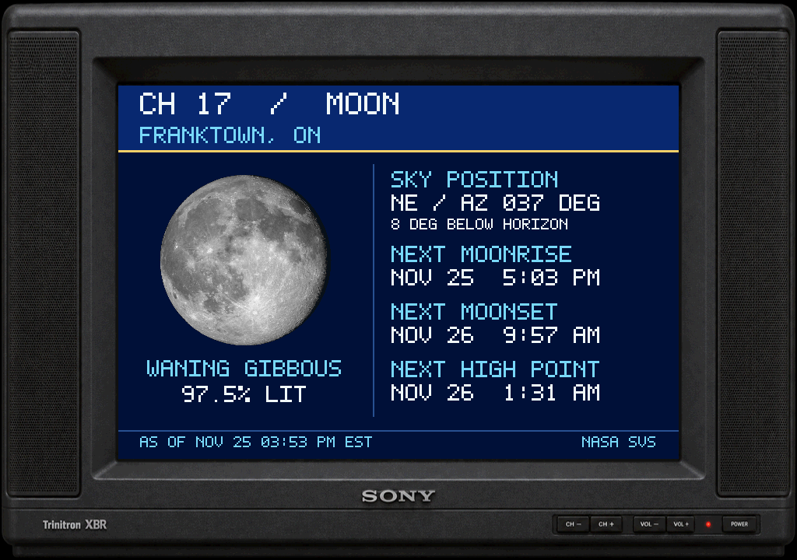
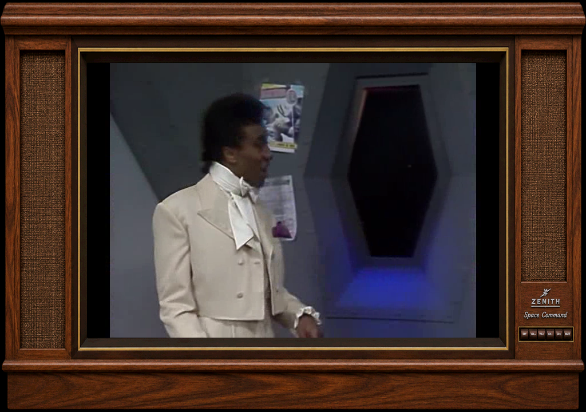

# RetroTV

RetroTV turns a MiSTer FPGA into a channel-surfing CRT. Add your own movies,
music, or pictures, or tune to the built-in blue information channels.
Movies on each channel run on a shared broadcast clock, so switching back
joins the program already in progress.

[Download RetroTV for MiSTer](https://github.com/datagod/RetroTV/releases/latest) ·
[Installation and setup](INSTALL.md)

On 1080p HDMI, RetroTV opens on a late-1980s Trinitron XBR-inspired set.
The tube opening displays a 720×480 picture pixel-for-pixel. Up and Down
cycle through six cabinets. F4 returns to the default cabinet.

| Key | Action |
| --- | --- |
| Left / Right | Change channel |
| Up / Down | Change cabinet |
| F4 | Return to the default XBR cabinet |
| N / P | Next / previous video or song |
| Space | Pause or resume |
| M | Mute or unmute |
| Print Screen | Save the TV picture to CH 50 |
| Esc | Return to the MiSTer menu |

## Built-in channels

| Channel | What it shows |
| --- | --- |
| 12 · News | World headlines from BBC, NPR, and Deutsche Welle |
| 13 · Stock News | Tech, AI and space headlines, with available market quotes |
| 14 · Weather | Nearby observations and a local forecast |
| 15 · What's On Now | The schedule for your own channels |
| 16 · Space Desk | Launches, ISS passes, and space headlines |
| 17 · Moon | Local phase, sky position, moonrise and moonset in one still snapshot per day |
| 50 · Screenshots | Saved TV pictures with slide transitions |

The download includes these channels, the cabinet artwork, and a stock image
for music channels. Add your own media using the [channel setup instructions](INSTALL.md#add-your-own-channels).

The optional [CH 51 – Test Cards slideshow](INSTALL.md#add-the-test-card-channel)
plays seven historical TV test patterns, one every 20 seconds.

## Building

Build the FPGA source with Quartus Prime Lite 17.0 using
`quartus_sh --flow compile Raster`. The Quartus project retains its upstream
filename and writes `output_files/Raster.rbf`. The installer ships the
bitstream as `RetroTV.rbf`. See the [build and package instructions](RetroTV/BUILD.md).

## Changes from Raster

The initial RetroTV release adds timed channels, direct MPG mounts,
slideshow and MP3 playback, six CRT cabinets, and six information
channels. See the [RetroTV release notes](https://github.com/datagod/RetroTV/releases)
for dated builds.

## Credits and license

RetroTV is based on [aquasock's MiSTer-Raster v0.10.0](https://github.com/aquasock/MiSTer-Raster/tree/v0.10.0)
at commit `08effcd8b27f334ad736ba7fb1fcc2863a579b91`. Thank you to aquasock
and the Raster, Phosphor, and MiSTer contributors for the MPEG-2 and MP2
player, the MiSTer framework, and the work that made RetroTV possible.

The complete FPGA design is distributed under GPL-3.0-or-later. Original
Raster code retains GPL-2.0-or-later, and individual LGPL and vendor
components retain their terms. The release includes a patched MiSTer Main
for direct file mounting and links to its matching source. See
[upstream attributions](ATTRIBUTIONS.md), [GPLv3](COPYING),
[GPLv2](LICENSE.txt), [LGPLv3](COPYING.LESSER), and
[additional credits and licenses](RetroTV/THIRD_PARTY.md).
